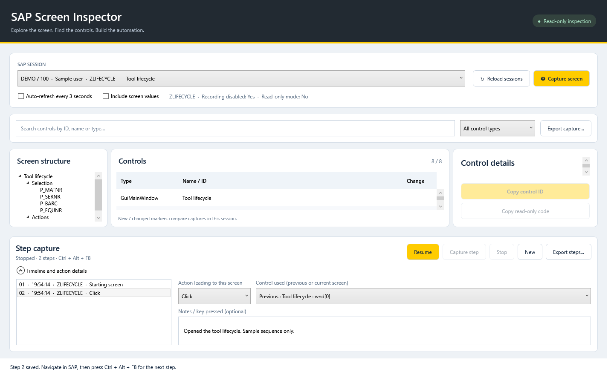

# SAP Screen Inspector

A portable Windows tool for inspecting SAP GUI controls and capturing an annotated sequence of screens.

**This is manual step capture, not automatic click recording or a replayable SAP script.** It uses read-only SAP GUI Scripting access and does not require recording events. SAP scripting access must still be enabled.

## Features

- Discover running SAP sessions and choose the one to inspect.
- Browse a control tree and search by ID, name, type, tooltip or included value.
- Copy control IDs and read-only VBScript snippets.
- Inspect grid column IDs without scrolling or reading grid row contents.
- Capture ordered steps with **Ctrl+Alt+F8**, then annotate actions and controls.
- Select a control from the previous screen when it disappears after an action.
- Export individual snapshots or the complete sequence as JSON.
- Optional auto-refresh outside step-capture mode.
- Password controls excluded; screen values excluded by default.
- Isolated reader process with a 25-second timeout.

## Use

1. Open SAP GUI for Windows and log in.
2. Run the inspector in the same Windows desktop/session as SAP.
3. Select the SAP session and choose **Start** to save the initial screen.
4. Perform one action in SAP and wait for it to finish.
5. Press **Ctrl+Alt+F8** to capture the next screen. Repeat for each action.
6. Choose **Stop**, review the timeline, and label the actions and controls.
7. Choose **Export steps** to save the sequence.

**Capture screen** and **Export capture** also work without starting a sequence.
If the hotkey is already registered by another program, use **Capture step**.

## Requirements and limits

- Windows with SAP GUI for Windows and permitted SAP GUI Scripting access.
- For Citrix/RDP, run the inspector inside the same environment as SAP.
- It cannot bypass disabled scripting permissions.
- Only currently instantiated controls are captured. Hidden tabs and virtualized grid rows require manual navigation.
- Captures read the screen after your action; they do not infer which control you clicked.
- The inspector never clicks controls, edits SAP fields, starts transactions, changes SAP settings or scrolls SAP grids.
- Sequences remain in memory until exported. The app warns before discarding unexported steps.
- Turning off value capture does not erase values in earlier steps.
- Exports include SAP system/client, username, control metadata and any explicitly included screen values.

## Build

Install the .NET 8 SDK on Windows:

~~~powershell
dotnet build -c Release
dotnet publish -c Release -r win-x64 --self-contained true -p:PublishSingleFile=true -p:IncludeNativeLibrariesForSelfExtract=true -p:DebugType=None -o releases/win-x64
dotnet publish -c Release -r win-x86 --self-contained true -p:PublishSingleFile=true -p:IncludeNativeLibrariesForSelfExtract=true -p:DebugType=None -o releases/win-x86
~~~

The published executables do not need a separate .NET installation.

## Development checks

~~~powershell
SAP-Screen-Inspector.exe --demo
SAP-Screen-Inspector.exe --self-test
SAP-Screen-Inspector.exe --smoke
~~~

The demo uses sample controls without connecting to SAP.
Self-tests cover discovery, traversal, hidden values, password exclusion, changed-session handling and serialization.
The smoke test exercises the timeline and annotations, checks sequence serialization, and renders a preview.

Tests use simulated SAP objects; live compatibility must be checked in your SAP environment.

## Project layout

- Reader.cs: read-only SAP discovery/capture and isolated worker process.
- SapDispatch.cs: late-bound COM access without an SAP interop assembly.
- Main.xaml: WPF interface.
- Program.cs: application entry point and inspector controller.
- StepCapture.cs: timeline, global hotkey, annotations and sequence export.
- SelfTests.cs: simulated SAP fixtures and checks.

Independent project; not affiliated with or endorsed by SAP.
